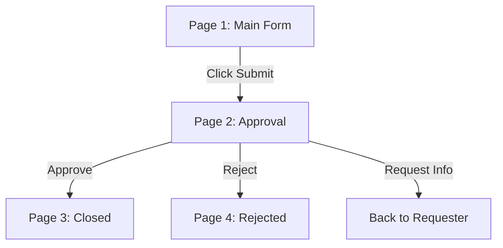

# Domino → M365 Migration

## What This Skill Does

Provides end-to-end procedures for migrating Lotus/HCL Domino applications to Microsoft 365. Covers the full lifecycle: source analysis, target design, implementation, and documentation.

Use this skill when asked to:
- Analyze Domino forms, fields, or workflows
- Design SharePoint lists from Domino schemas
- Build Power Apps code-first applications
- Create Power Automate flows to replace Domino agents
- Generate field mappings and migration documentation

---

## 1. DXL/XML Analysis

### When to Use
- Parsing Domino DXL export files (`.xml`, `.dxl`)
- Extracting form definitions, field lists, views, and agents
- Understanding Domino field types, formulas, and validation
- Building a complete field inventory from Domino source

### DXL Structure Reference

Domino DXL uses these key XML elements:

| DXL Element | Purpose | Key Attributes/Children |
|-------------|---------|------------------------|
| `<form>` | Form definition | `name`, `alias`, `fields` children |
| `<field>` | Field definition | `name`, `type`, `kind`, `formula` child |
| `<view>` | View definition | `name`, `selection`, `columns` |
| `<agent>` | Agent definition | `name`, `trigger`, `action` |
| `<item>` | Data item in a document | `name`, `type`, text/number content |
| `<text>` | Text field value | Content |
| `<number>` | Number field value | Content |
| `<datetime>` | Date/time value | Content |
| `<formuladef>` | Formula definition | Formula text content |
| `<code>` | LotusScript code | Code content |
| `<action>` | Button/action definition | `title`, `code` child |

### Procedure

1. **Locate source files**: Check `source/dxl/` for DXL/XML exports. Files are typically organized by department (e.g., `XML_IT_Johor/`, `XML_IT_Penang/`).

2. **Quick-scan the DXL for structure**: Before deep parsing, scan for top-level elements:
   ```xml
   <form name="FormName" alias="AliasName">
   <field name="FieldName" type="Text" kind="Editable">
   <view name="ViewName">
   <agent name="AgentName" triggers="manual|scheduled|event">
   ```

3. **Parse each form** to extract:
   - **Form identity**: `name` attribute, `alias` attribute (comma-separated aliases), form inheritance from `extends` attribute
   - **Fields** — for each `<field>` element:
     - `name` — Domino internal name (e.g., `IT_ITSSR_Status`)
     - `type` — Domino type keyword: `Text`, `Number`, `Datetime`, `Keywords`, `RichText`, `Names`, `Authors`, `Readers`, `Password`, `Time`, `TimeZone`, `DateTime`, `Formula`
     - `kind` — `Editable`, `Computed`, `ComputedForDisplay`, `ComputedWhenComposed`
     - Nested `<formuladef>` — formula expression (e.g., `@If(Status="Open"; "Pending"; Status)`)
     - `<keywordlist>` child elements for Keywords fields (list of keyword choices)
     - `<text>` default value if present
   - **Keyword lists**: Parse `<choice>` elements inside `<keywordlist>` for single/multi-select values
   - **Computed fields**: Note formula text — these need a Power Fx equivalent
   - **Validation formulas**: Look for `@If`, `@IsAvailable`, `@Matches` patterns

4. **Extract views**:
   - View `name` and selection formula (`<select>` element)
   - Column definitions: `title`, formula, sorting
   - This tells you how data is organized and filtered — informs SharePoint view design

5. **Extract agents**:
   - Agent `name`, trigger type (`manual`, `scheduled`, `before|after|event`)
   - Scheduled triggers: note recurrence (daily, weekly, custom)
   - Event triggers: `queryopen|queryclose|postopen|postclose|querymodechange|postmodechange|querysave|postsava|querysave|postsave` (Domino events)
   - Actions: mail send, document update, run LotusScript/Java
   - Document the full agent logic — this becomes the Power Automate flow spec

6. **Document the analysis** in `analysis/domino-field-inventory.md` using a table format:

   ```markdown
   | Form | Field Name | Domino Type | Kind | Size/Formula | Notes |
   |------|-----------|-------------|------|-------------|-------|
   | ITSSR | IT_ITSSR_Status | Text | Editable | 128 | Approval status, keyword list: Open/In Progress/Closed |
   | ITSSR | IT_ITSSR_Date | Datetime | Editable | - | Date picker, default = @Today |
   | ITSSR | IT_ITSSR_AutoID | Text | ComputedWhenComposed | @Unique | Auto-generated ID, read-only |
   ```

7. **Cross-reference** with PDF UI evidence in `analysis/evidence-reconciliation.md`. For each form, create a reconciliation table:

   ```markdown
   | Field | In DXL? | In PDF UI? | Notes |
   |-------|---------|------------|-------|
   | Status | ✅ | ✅ | Matches |
   | Date | ✅ | ✅ | Matches |
   | AutoID | ✅ | ❌ Hidden field | Computed, no UI element |
   | HiddenField | ✅ | ❌ Hidden field | Internal use only |
   | NewField | ❌ | ✅ | Found in UI only — check form version |
   ```

---

## 2. PDF/Screenshot UI Inventory

### When to Use
- Cataloging screens, tabs, sections from Domino PDF exports
- Identifying all data entry fields and display-only fields
- Mapping UI flow and navigation patterns
- Understanding how Domino forms are organized across pages/tabs

### Source Format Detection

Files in `source/pdf/` come in two formats. Always verify before processing:

| Indicator | Real PDF | Domino Project Container |
|-----------|----------|-------------------------|
| Extension | `.pdf` | `.pdf` (misleading) |
| Actual type | PDF document | ZIP archive |
| Detection | `file` command → "PDF document" | `file` command → "Zip archive data" |
| Contents | Text + images | `manifest.json`, `1.jpeg`, `1.txt`, etc. |
| How to read | PDF viewer | Extract ZIP, read TXT + view JPEG |

For Domino containers, use the [domino-form-reader](./ioicodeapp/.github/skills/domino-form-reader.md) skill.

### UI Elements to Capture Per Form

For each form, systematically capture:

**Page/Tab Layout:**
- Number of pages/tabs (e.g., "Main", "Approval", "Details")
- Section groupings within each page (bordered sections with labels)
- Tab sequence and conditional tab visibility

**Data Entry Fields (focus on visible labels matching Domino field names):**
- Text input fields (single-line, multi-line)
- Date pickers and time fields
- Dropdown/combobox fields (keyword lists)
- Checkbox groups and radio button groups
- Rich text areas
- Name/reader fields (person picker, address book dialog)
- File attachment fields
- Field order on the form (left-to-right, top-to-bottom)

**Display-Only Elements:**
- Computed text values (e.g., "Status: Open" shown as colored text)
- Read-only fields (grayed out, no edit cursor)
- Section labels and instructions
- Conditional sections (shown/hidden based on field values)

**Buttons and Actions:**
- Submit/Save buttons
- Cancel/Close buttons
- Action bar items (menu at top of form)
- Custom buttons (e.g., "Print", "Email", "Archive")
- Button behavior description (what each button does)

**Approval Workflows:**
- Approval grid tables (columns: Approver, Status, Date, Comment)
- Status indicators (color-coded status fields)
- Signature fields
- Date stamps (Created, Last Modified, Approved)
- Routing logic (who approves next, escalation rules)

**Access Control:**
- Role-based sections visible only to certain users
- Read/Write/Manager access per role
- Reader names fields (access lists)

### Documenting Findings

Create `analysis/pdf-ui-inventory.md` with this structure per form:

```markdown
# PDF UI Inventory: {Form Name}

## Source
- File: `source/pdf/{filename}.pdf`
- Type: [Real PDF | Domino Container]
- Form name from UI: {visible form title}
- Pages: {count}

## Page 1: {Page Title}
### Sections
| Section | Fields | Description |
|---------|--------|-------------|
| Requester Info | Name, Dept, Phone | Top section, all required |
| Request Details | Title, Description, Priority | Middle section |

### Field Inventory
| # | Label | Field Type | Domino Field | Control Type | Required |
|---|-------|-----------|-------------|-------------|----------|
| 1 | Requestor Name | Text | IT_ITSSR_ReqName | Text input | Yes |
| 2 | Department | Dropdown | IT_ITSSR_Dept | Combo box | Yes |
| 3 | Date | Date | IT_ITSSR_Date | Date picker | Yes |
| 4 | Description | Multi-line Text | IT_ITSSR_Desc | Text area | No |

### Buttons
| Button | Action | Visible When |
|--------|--------|-------------|
| Submit | Creates document, sends email | Always |
| Save Draft | Saves without workflow trigger | Always |
| Approve | Sets status, notifies next approver | Status = "Pending" AND user is approver |
```

### UI Flow Mapping

Map navigation between pages, conditional logic:



### Reconciliation

After documenting, reconcile with DXL evidence from `analysis/domino-field-inventory.md`. For each discrepancy, log in `analysis/evidence-reconciliation.md` explaining why the difference exists (e.g., hidden field, computed field with no UI, different form version).

---

## 3. SharePoint List Design

### When to Use
- Designing SharePoint lists to replace Domino databases
- Mapping Domino field types to SharePoint column types
- Creating calculated columns and lookup tables
- Planning permissions, versioning, and retention
- Designing parent-child list architectures for multi-department forms

### Domino-to-SharePoint Type Mapping

| Domino Type | SharePoint Column Type | Notes |
|-------------|----------------------|-------|
| Text (single line, up to 256 chars) | Single line of text | Set max length to match Domino |
| Text (multi-line, >256 chars) | Multiple lines of text | Use plain text unless rich formatting needed |
| Number (integer) | Number (0 decimals) | Set min/max if Domino has validation |
| Number (decimal) | Number (2 decimals) | Match precision to Domino |
| Date/Time (date only) | Date and Time (Date only) | Domino dates include time by default |
| Date/Time (date + time) | Date and Time (Date + Time) | Use 12/24h matching Domino locale |
| Rich Text | Multiple lines of text (Enhanced text) | Plain text fallback if formatting not critical |
| Keyword (single select) | Choice | Add "—" as first option for no-selection |
| Keyword (multi-select) | Choice (Allow multiple selections) | Important: Power Apps needs special handling |
| Names (single) | Person or Group (Allow selection of: People only) | Single selection |
| Names (multiple) | Person or Group (Allow selection of: People only, multiple) | Multi-select |
| Authors | Person or Group (with Created By system field) | System-managed |
| Readers | Person or Group | Maps to SharePoint item-level permissions |
| Computed fields | Calculated column OR Power Apps formula | Prefer calculated columns for simple formulas |
| Time/TimeZone | Single line of text | SharePoint has no time-only column |
| Password | Single line of text | Store encrypted; use Power Apps to mask |
| Attachment | Attachment column | SharePoint has native attachment support |

### Column Naming Conventions

- **Internal Name**: Use PascalCase matching Domino field name where possible (e.g., `ITSSR_Status`)
- **Display Name**: Use friendly names with spaces (e.g., "ITSSR Status")
- **Max length**: 32 chars for Internal Name (SharePoint limit for some operations)

### Procedure

1. **Design each list** in `m365-design/sharepoint-list-design.md` using this template:

   ```markdown
   ## List: {List Name}

   ### Metadata
   - **Description**: {purpose of this list}
   - **Template**: Custom List
   - **Versioning**: [Major versions | Major + Minor]
   - **Draft Approval**: [Yes | No]
   - **Permission**: [Inherit from parent | Unique permissions]

   ### Columns

   | Internal Name | Display Name | Type | Required | Max Length | Default | Formula/Choices |
   |--------------|-------------|------|----------|-----------|---------|----------------|
   | {Name} | {Display} | {SP type} | Yes/No | {n} | {value} | {choices or formula} |
   | Title | Title | Single line of text | Yes | 255 | — | System column (rename if needed) |

   ### Indexed Columns
   - {Column 1} — used in sorting/filtering
   - {Column 2} — used in lookup relationships

   ### Lookup Tables Required
   - **{Lookup List Name}**: For field `{Domino field}` — values: {value1}, {value2}, ...
   ```

2. **Design lookup tables for Domino keyword fields**: Domino keyword fields with predefined lists become separate SharePoint lookup lists. Benefits:
   - Single source of truth for keyword values
   - Easy to update without modifying the main list schema
   - Enables cascading dropdowns in Power Apps
   - Example: `IT_Department` lookup list → departments used across forms

3. **Handle parent-child list architecture**:
   - `MainDB_Master` — Parent list containing common fields shared across all departments:
     - Title, Created By, Modified, Status, Department, etc.
   - `MainDB_{Dept}` — Child lists per department (e.g., `MainDB_IT`, `MainDB_HR`) with:
     - A lookup column back to `MainDB_Master` (linked item ID)
     - Department-specific fields only
   - Power Apps surfaces the combined view by loading both lists and joining on the link
   - Alternative: Use a single list with department-specific columns and conditional visibility

4. **Calculated columns**:
   - SharePoint calculated columns support simple formulas (Excel-like)
   - Complex formulas should be handled in Power Apps instead
   - Example: `=TEXT(Created,"yyyy-mm-dd") & " - " & Title` for display title
   - Domino `@Today` → SharePoint `=NOW()` or Power Apps `Now()`
   - Domino `@Unique` → handled by SharePoint's auto-ID (Title sequence)

5. **Versioning and retention**:
   - Major versions only unless draft approval is needed
   - Set retention labels via Microsoft Purview if compliance required
   - Document retention schedule in the list design

6. **Permissions**:
   - Default: Inherit from site (Members contribute, Visitors read)
   - Unique permissions: For forms with Domino reader/author fields
   - Item-level permissions: Use Power Apps + Power Automate to set `_BreakRoleInheritance`

---

## 4. Power Apps Code-First App Development

### When to Use
- Building Power Apps using the new code-first (code-first) approach
- Writing Power Fx formulas to replace Domino @Functions
- Connecting to SharePoint lists as data sources
- Working with the Power Apps VS Code extension and PAC CLI

### Domino @Function → Power Fx Reference

This table maps the most common Domino @Functions to their Power Fx equivalents:

| Domino @Function | Power Fx Equivalent | Notes |
|-----------------|-------------------|-------|
| `@Today` | `Today()` | Returns current date |
| `@Now` | `Now()` | Returns current date + time |
| `@Unique` | `GUID()` or `TextField.Default = "IOI-" & CountRows(SPList) + 1` | GUID for unique; sequential for readable IDs |
| `@If(a; b; c)` | `If(a, b, c)` | Same logic, different syntax (; → ,) |
| `@Trim(string)` | `Trim(string)` | Remove leading/trailing spaces |
| `@UpperCase(string)` | `Upper(string)` | Convert to uppercase |
| `@LowerCase(string)` | `Lower(string)` | Convert to lowercase |
| `@Left(string; n)` | `Left(string, n)` | First n characters |
| `@Right(string; n)` | `Right(string, n)` | Last n characters |
| `@Middle(string; start; end)` | `Mid(string, start, end - start + 1)` | Substring |
| `@Length(string)` | `Len(string)` | String length |
| `@Contains(string1; string2)` | `string1 in string2` | Substring check |
| `@Matches(pattern)` | `IsMatch(string, pattern)` | Regex matching (Match enum) |
| `@Replace(string; old; new)` | `Substitute(string, old, new)` | String replacement |
| `@Prompt([OK]; title; msg)` | `Notify(msg)` or `Confirm()` | Dialogs; use `Notify` for toast, `Confirm` for yes/no |
| `@Success` | — | No direct equivalent; use `Notify("Success", NotificationType.Success)` |
| `@Failure` | — | Use `Notify("Error", NotificationType.Error)` |
| `@DbColumn` / `@DbLookup` | `Distinct(Filter(SPList, ...), Column)` or `LookUp(SPList, ...)` | Use Power Fx table operations |
| `@UserName` | `User().Email` or `User().FullName` | Current user info |
| `@UserRoles` | Check `DataSourceInfo(SPList, DataSourceInfo.UserPermissions)` | Role checking is more limited in SP |
| `@IsMember(role)` | `DataSourceInfo(SPList, DataSourceInfo.UserPermissions)` | Group membership check |
| `@DocUniqueID` | `SPList.ID` (GUID) or `ThisItem.ID` | SharePoint item ID |
| `@DocCreated` | `ThisItem.Created` | System field in SharePoint |
| `@DocModified` | `ThisItem.Modified` | System field in SharePoint |
| `@MailSend` | Power Automate flow trigger | No direct Power Fx email send |
| `@PickList(values; label)` | Dropdown control with `Items` property | UI control, not a function |
| `@Sum(a; b; ...)` | `Sum(table, column)` or `a + b` | Collection sum or arithmetic |
| `@Round(n; decimals)` | `Round(n, decimals)` | Rounding |
| `@TextToTime(string)` | `DateValue(string)` or `DateTimeValue(string)` | String → date |
| `@TimeToText(date)` | `Text(date, "mm/dd/yyyy")` | Date → formatted string |

### Procedure

1. **Prerequisites**:
   - Power Apps VS Code extension installed
   - PAC CLI authenticated (`pac auth create`)
   - Target environment selected (`pac org select --environment {env-id}`)
   - Existing app opened or new app initialized

2. **App project structure** (code-first):

   ```
   ioicodeapp/
   ├── app.js              # App entry point, theme, global settings
   ├── project.json        # App metadata (name, ID, version)
   ├── package.json        # Node.js dependencies
   ├── index.html          # Host page
   ├── data.json           # Data source connections registered here
   ├── styles.css          # Custom styling
   └── src/
       ├── screens/        # Screen components (one per form/page)
       ├── components/     # Reusable controls (header, footer, dialogs)
       └── services/       # Data layer (SharePoint connections)
   ```

3. **Create screens for each Domino form tab**:
   - One screen per Domino page/tab (e.g., `Screen_MainForm`, `Screen_Approval`, `Screen_Details`)
   - Add `Button` navigation controls: `Navigate(Screen_Approval)`, `Back()`
   - Use `Form` control bound to SharePoint list for data entry
   - Use `Gallery` control for list views matching Domino views

4. **Connect to SharePoint lists**:
   - In `data.json`, register each SharePoint list connection
   - In Power Fx, refer to lists by connection name: `Filter(SP_MainDB_IT, Status = "Open")`
   - For parent-child lists: `LookUp(SP_MainDB_Master, ID = ParentID).Title`

5. **Implement Domino logic in Power Fx**:

   **Form load (replaces Domino `QueryOpen` agent):**
   ```powerfx
   Set(varFormMode, If(Param("ID") = "", "New", "Edit"))
   Set(varUserEmail, User().Email)
   ```

   **Auto-number (replaces Domino `@Unique` or computed field):**
   ```powerfx
   Set(varNewID, "ITSSR-" & Text(CountRows(SP_MainDB_IT) + 1001, "0000"))
   ```

   **Conditional visibility (replaces Domino hide-when formulas):**
   ```powerfx
   // Button visible only when status is pending and user is approver
   btnApprove.Visible = DataCardValueStatus.Selected.Value = "Pending"
       && LookUp(SP_Approvers, UserEmail = varUserEmail).Role = "Approver"
   ```

   **Save to SharePoint (replaces Domono document save):**
   ```powerfx
   Patch(SP_MainDB_IT,
       If(varFormMode = "Edit", LookUp(SP_MainDB_IT, ID = varRecordID), Defaults(SP_MainDB_IT)),
       {
           Title: txtTitle.Text,
           ITSSR_Status: ddStatus.Selected.Value,
           ITSSR_Date: dpDate.SelectedDate,
           ITSSR_ReqName: txtRequestor.Text
       }
   )
   ```

6. **Approval workflow integration**:
   - Status field drives workflow: Draft → Submitted → Pending → Approved/Rejected
   - Use `Patch` to update status
   - Trigger Power Automate flow via `PowerAutomate.Run()` (or via button)
   - Show relevant action buttons based on current user and status

7. **Test and debug**:
   - Open the Power Apps player from VS Code
   - Test form creation, editing, and all workflow transitions
   - Monitor formula errors in the formula bar (red underlines)
   - Verify data in SharePoint list directly

---

## 5. Power Automate Integration

### When to Use
- Replacing Domino agents with Power Automate flows
- Automating email notifications, approvals, and scheduled tasks
- Integrating with SharePoint and Microsoft 365
- Handling data transformations during migration

### Domino Agent → Power Automate Mapping

| Domino Agent Property | Power Automate Equivalent | Notes |
|----------------------|--------------------------|-------|
| Manual trigger (button) | Instant flow (manual trigger) | Button in Power Apps calls flow |
| Scheduled (daily/weekly) | Scheduled flow (Recurrence trigger) | Set frequency matching Domino schedule |
| Document created | Automated flow (When item is created) | SharePoint trigger |
| Document modified | Automated flow (When item is modified) | SharePoint trigger |
| Document deleted | Automated flow (When item is deleted) | SharePoint trigger |
| QueryOpen/QuerySave | Automated flow (When item is created/modified) + condition | Domino events mapped to SharePoint triggers |
| @MailSend | Send an email (V2) action | Configure To/Cc/Bcc from SharePoint fields |
| @Prompt user | Approval (Start and wait for an approval) | Replaces modal dialogs |
| LotusScript update | Update item action | Use dynamic content from trigger |
| LotusScript routing | Condition + Create item in other list | Branching logic |
| @DbColumn lookup | Get items (filter by query) | SharePoint connector |
| Error handling | Configure Run After settings | Set fallback actions on failure/timeout |

### Procedure

1. **Analyze Domino agents** from `analysis/workflow-analysis.md`

   For each Domino agent, document:
   - **Agent name** — same as Domino agent name
   - **Trigger type**: Manual (button), Scheduled (daily/weekly/monthly), Event (document create/update/delete), Email (mail received)
   - **Trigger conditions**: e.g., "Only runs when Status = 'Pending'"
   - **Actions in order**: e.g., "1. Send email to manager. 2. Update Status to 'Notified'. 3. Set TimeStamp to @Now"
   - **Error handling**: What happens on failure (e.g., "Set Status to 'Error'")
   - **LotusScript/Formula**: Paste the original code for reference

   Store this in `analysis/workflow-analysis.md` with this format:

   ```markdown
   ## Agent: {Agent Name}

   | Property | Value |
   |----------|-------|
   | Form | {Associated Domino form} |
   | Trigger | {Manual / Scheduled / Event} |
   | Schedule | {If scheduled: frequency, time} |
   | Condition | {Trigger condition formula} |
   | Actions | {Bullet list of actions} |

   ### Original Code
   ```lotusscript
   ' Paste the original LotusScript or formula here
   ```

   ### M365 Equivalent
   - **Flow name**: {Flow Name}
   - **Trigger**: {Power Automate trigger}
   - **Actions**: {Power Automate action list}
   ```

2. **Design each flow** in `m365-design/power-automate-design.md`

   Use this template for each flow:

   ```markdown
   ## Flow: {Flow Name}

   ### Trigger
   - **Type**: [When item is created/modified | Recurrence | Manual]
   - **List**: {SharePoint list name}
   - **Condition**: {e.g., "Status equals 'Pending'"}

   ### Actions
   1. **Get manager**: Microsoft 365 Users → Get manager
      - User: `Email` field from trigger
   2. **Send email**: Outlook → Send an email (V2)
      - To: Manager email from step 1
      - Subject: `"New Request: " & Title`
      - Body: `"A new request has been submitted by " & Requestor`
   3. **Update item**: SharePoint → Update item
      - ID: ID from trigger
      - Status: `"Notified"`
      - LastNotified: `@{utcNow()}`

    ### Error Handling
    - If Get manager fails: Continue (no manager found, send to default)
    - If Send email fails: Update Status to "Email Failed"
    ```

3. **Common flow patterns in detail**:

   **a) Email Notification Flow (replaces @MailSend):**
   ```
   Trigger: When item is created
   → Condition: Item.Status = "Submitted"
     → Get user profile (from Created By email)
     → Send email (To: Manager, Subject: "New Request", Body: dynamic content)
     → Update item: Status = "Notified", NotificationDate = utcNow()
   ```

   **b) Approval Workflow Flow (replaces Domino approval routing):**
   ```
   Trigger: When item is modified (Status changed to "Pending Approval")
   → Start and wait for an approval (Assigned to: Approver field)
     → If approved: Update item Status = "Approved", ApprovedBy = user
     → If rejected: Update item Status = "Rejected", RejectionReason = comment
     → Send email notification to Requester
   ```

   **c) Scheduled Archive Flow (replaces Domino scheduled agent):**
   ```
   Trigger: Recurrence (Daily at 2:00 AM)
   → Get items: Filter(SP_List, Status = "Closed" AND Modified < addDays(utcNow(), -365))
   → Apply to each:
     → Create item in Archive_List (copy all fields)
     → Delete item from source list
   ```

   **d) Document Routing Flow (replaces @DbColumn document routing):**
   ```
   Trigger: When item is created
   → Condition: Department = "IT"
     → Create item in MainDB_IT (link to parent)
   → Condition: Department = "HR"
     → Create item in MainDB_HR (link to parent)
   ```

4. **Connectors to use**:

   | Connector | Purpose | Common Actions |
   |-----------|---------|---------------|
   | SharePoint | Read/write list data | Get items, Create item, Update item, Delete item |
   | Microsoft 365 Users | User directory | Get user profile, Get manager, Get direct reports |
   | Outlook 365 | Email from shared mailbox | Send email, Send calendar invite |
   | Approvals | Approval workflows | Start and wait for approval |
   | Teams | Notifications | Post message, Post adaptive card |
   | Dataverse | If using Power Apps premium | Various CRUD operations |
   | HTTP | Custom API calls | For legacy system integration |
   | Encodian | PDF/document generation | Create PDF from template (premium) |

5. **Test and document**:

   - **Test each flow independently** with sample data:
     - Run flow with a test item
     - Verify all branches execute correctly
     - Check error paths (e.g., invalid email, missing manager)
   - **Integration testing**: Test flow from Power Apps button → flow → SharePoint update → notification
   - **Document**: For each flow, record in `m365-design/power-automate-design.md`:
     - Flow name and purpose
     - Trigger type and conditions
     - Complete action list with configuration
     - Connectors used and authentication method
     - Test results and known limitations

---

## Output Standards

All analysis and design outputs should follow the templates in `agent/output-templates.md`. Key requirements:

- **Field mapping**: Record in `mapping/field-mapping.csv` with columns: Domino Form, Domino Field, M365 Target, Field Type, Transformation Rule, Status
- **Evidence**: Cross-reference DXL evidence with PDF evidence in `analysis/evidence-reconciliation.md`
- **Decisions**: Record risks, assumptions, and questions in `docs/risks-assumptions-questions.md`
- **Review**: Use `agent/review-checklist.md` before finalizing any design or migration artifact
