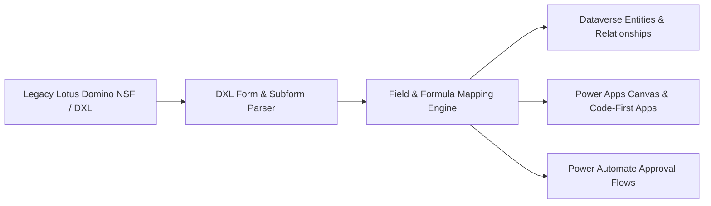

# IOI Domino to Microsoft 365 & Power Platform Migration Monorepo

[]()
[](https://powerplatform.microsoft.com)
[](https://learn.microsoft.com/power-apps/maker/data-platform/)
[]()

**IOI Domino to Microsoft 365 Migration Monorepo** serves as the authoritative knowledge base, architectural blueprint, schema mapping registry, and automation toolset for modernizing legacy IBM Lotus Notes/Domino databases into Microsoft 365, Power Platform, and Microsoft Dataverse for IOI Acidchem Sdn Bhd.

---

## 🌟 Modernization Framework



### 1. DXL Form & Schema Parsing
- Converts legacy Domino DXL forms, subforms, field data types, keyword formulas, and `@Formula` logic into strongly-typed TypeScript and Dataverse entity definitions.

### 2. Hide-When & Security Translation
- Translates Domino hide-when formulas and ACL roles into Power Apps conditional visibility properties and Dataverse Role-Based Access Control (RBAC).

### 3. Multi-Tier Enterprise Approval State Machines
- Replaces legacy Domino background agents with event-driven Power Automate cloud flows supporting multi-stage approvals (`Draft` ➔ `Department Head` ➔ `Plant General Manager` ➔ `Completed`).

---

## 📁 Repository Structure

```
ioi-domino-m365-migration/
├── .github/
│   ├── agents/             # Autonomous migration agents (.agent.md)
│   ├── instructions/       # Domino modernization operating instructions
│   └── skills/             # Reusable migration skills & schema transformers
├── architecture/           # System topology, ERDs, and governance docs
├── dxl-schemas/            # Parsed DXL form exports and source dictionaries
├── dataverse-models/       # Entity relationship diagrams and solution XMLs
├── power-automate-flows/   # Cloud flow definitions and approval triggers
└── AGENTS.md               # Agent guidelines and quality policies
```

---

## 📄 License & Attribution
Authored and maintained by **Ali Akhmad Fauzie** ([@aliakhmadfauzie](https://github.com/aliakhmadfauzie)), Enterprise Solutions Architect.
